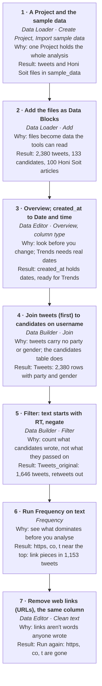
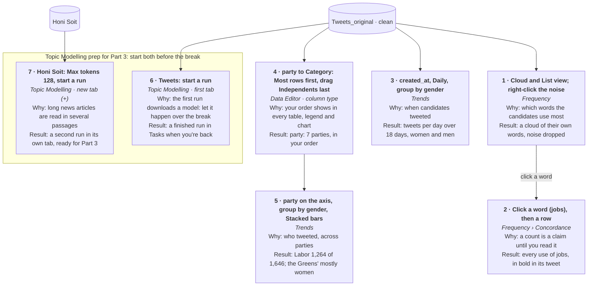
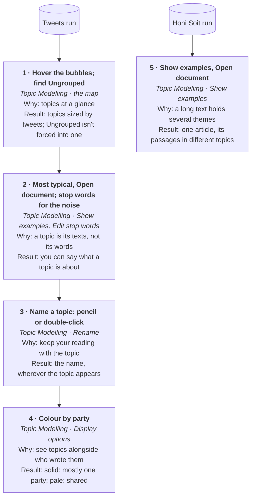
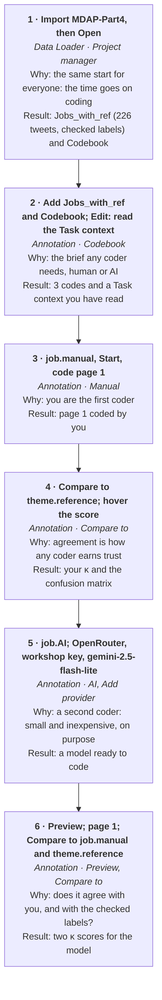

# Hands-on: Point-and-click text analytics with Wordflow

**University of Melbourne · Monday 26 October 2026 · 2:00-5:00 pm · Meeting Room M03, Mezzanine, Melbourne Connect**
*Hosted by the Melbourne Data Analytics Platform, LDaCA and the Sydney Informatics Hub*

Each part starts with a few minutes on screen, then it's your turn.

- **Try it** is the main steps: the same for everyone, and the only ones we expect you to finish. Take your time; helpers come to you.
- **If you finish early**: a few ideas to try, in any order. They're suggestions, not tasks.

Each part opens with a small chart of its Try it steps: for each, the task, the tool (in italics), why, and the result to check for. Round boxes are Data Blocks, the data a part starts from.

This sheet is also a web page, **sih.tools/ldaca**, with the workshop key for Part 4 and the checkpoint downloads.

Fall behind at any point? Load the part's **checkpoint** (the table at the end) and carry on. Names in **bold** are the exact words on Wordflow's buttons and menus.

---

## 0 · Before we start

1. **Open Wordflow** and accept the **update** it offers. No prompt? **Help → Check for Updates**. Not installed? `sih.tools/wordflow`: the desktop app for Mac or Windows, or **Launch in Binder** to run it in your browser.
2. **Keep this sheet open** beside Wordflow.
3. Stuck? Put your hand up: a helper will come to you.

Lightbulb **suggestions** may pop up as you work: they appear when a result looks off and point at the setting that may help. Read them, or click **Dismiss**.

---

## Part 1 · Shape your data (2:12)

### Try it

1. **A Project and the data.** In the **Data Loader**, under **Create Project**, type a name (for example `Melbourne`) and click **Create Project**. Click **Import sample data**, tick **Queensland Election Tweets** and **Honi Soit Student Newspaper** (and **RAPID-CDL: Australian Hansard, GST** if you'd like it for later: it's bigger, so let it download while you work), then **Import selected**.
2. **Files into Data Blocks.** Importing brings in files, not yet data. In the file list, open `sample_data` → `ADO` → `twitter`. Click **Add** beside `qldelection2020_candidate_tweets.csv`, then **Add to Project**. Do the same for `candidate_info_gender.csv`. Both appear in the **Project Graph**: 2,380 tweets, and 133 candidates with their party and gender. Then `sample_data` → `SCL`: **Add** beside `Honi_Soit.zip` → **Texts as one Data Block (100)** → **Add to Project**: 100 news articles from the University of Sydney's student newspaper, one row each, for Topic Modelling before the break.
3. **Look, then fix one thing.** Click the tweets block: the table under the graph is the **Data Editor**. Click **Overview** for a summary. The column `created_at` holds dates written as text: click the small type symbol at the left of its header, choose **Date and time**, then **Convert**. Trends needs real dates in Part 2.
4. **Join.** Open **Data Builder** in the sidebar, then **Join**. **Add Data Block**: the **tweets first** (the first one is the left table), then the candidates. Set **Left column** and **Right column** to `username`. **New Data Block name**: `Tweets`. Click **Add to Project**. Every tweet now carries its candidate's `party` and `gender`.
5. **Filter.** The **Filter** tab. **Add Data Block** `Tweets`, **Add condition**: `text`, **starts with**, `RT`, and tick **negate** (keep the tweets that do *not* start with RT, so retweets drop out). **New Data Block name**: `Tweets_original`. **Add to Project**. Check: **1,646 rows**.

**Clean the text, because the data tells you to**

6. **A first look.** Open **Frequency** in the sidebar. **Add Data Block** `Tweets_original`, **Text column** `text`, and under **Tokeniser model** pick the one under **Recommended**. **Run**. Among the biggest words: `https`, `co` and `t`. Nobody wrote them: they're the pieces of web links (`https://t.co/…`), which 1,153 of the 1,646 tweets carry.
7. **Clean them out.** Click `Tweets_original` in the Project Graph. In the **Data Editor**, **Clean text** → **Remove web links (URLs)**. **Column**: `text`; **Save result to**: **The same column**. The preview shows the links gone: **Apply**. Back in **Frequency**, **Run** again: `https`, `co` and `t` have left the cloud. Changed your mind? **Undo** in the Data Editor.

Look at the Project Graph: every step you took is a block, and the arrows are your method.

### If you finish early

- Make `gender` a **Category** (its type symbol → **Category** → **Convert**), then look at the Filter tab: categories become tick lists.
- Try another **Clean text** option, such as **lowercase**, on a copy of `text` (**Add column** → **Copy column…** first). **Undo** takes it back.
- Look at the Hansard GST data: `sample_data` → `RAPID-CDL` → `hansard_au_gst`, **Add** `Hansard_AU_gst_metadata.parquet`, and click **Overview**.

*Behind? Load **MDAP-Part1**: Part 1 done, with the Frequency result.*

---

## Part 2 · Look through the lenses (2:47)

Three tools, one move each, and Trends twice: over time, then across categories. Each is shown for a couple of minutes, then it's your turn.

### Try it

1. **Frequency: which words.** Your Frequency tab from Part 1 is still open, with clean text. Look at the **Cloud view** and the **List view**. Campaign noise (handles, names) crowding the cloud? **Right-click** a word to drop it.
2. **Concordance: in context.** **Click** a word in the cloud, for example `jobs`. A new **Concordance** tab opens, named after the word, with its matches already shown. **Click a row**: the tweet opens with the match in bold. **Next row** steps through them.
3. **Trends over time.** Open **Trends**. **Add Data Block** `Tweets_original`. **Time, number or category column**: `created_at`, **Daily**. **Add group**: `gender`. **Run**.
4. **A category in your own order.** Trends can also put a category along the bottom, one bar per value. On `Tweets_original` in the **Data Editor**, click the type symbol on `party` → **Category**. The window shows each party with its number of tweets: choose **Most rows first**, then **drag** `N/A (Independent)` to the end (or drag the parties into any order that suits your question). **Convert**.
5. **Trends across parties.** A new Trends tab (**+**), **Add Data Block** `Tweets_original`, **Time, number or category column**: `party`, **Add group**: `gender`, **Run**. One bar per party, in your order. **Chart** → **Stacked bars**. Labor wrote three tweets in four; most of the Greens' were by women.

### If you finish early

- In the day-by-day Trends, try **Chart** → **Bars**, or **Normalise to 100%**.
- In Concordance, switch to the **Dispersion view**: where in each tweet the word falls.
- Click a different word in the Frequency cloud and read it in Concordance.

### Before the break (3:17): Topic Modelling prep for Part 3

Two runs, one in each Topic Modelling tab, so both are ready when we're back. Topic Modelling takes a little while, so we start both now and they carry on over the break.

6. **Tweets.** Open **Topic Modelling**. **Add Data Block** `Tweets_original`, **Text column** `text`. Leave the settings as they are and click **Run**. If a lightbulb says your texts are short, click its **Use … tokens** button first. The first run downloads a model: watch it in **Tasks**.
7. **Honi Soit, in a second tab.** In **Topic Modelling**, open a **new tab** with **+**. **Add Data Block**: the Honi Soit block, **Text column** `document`. The lightbulb offers **Use 128 tokens**: click it (or set **Max tokens** to 128). **Run**. Each tab keeps its own settings and results: click between them.

*Behind? Load **MDAP-Part2**: Part 2's results, with both Topic Modelling runs finished, ready for Part 3.*

---

## Part 3 · Topics (3:35)

Three things here are new since August: reading a topic's texts, naming topics, and colouring the map by your own columns.

*No Topic Modelling runs to look at? Load **MDAP-Part2**: both runs are in it, finished.*

Wordflow reads each text in **passages**: a sentence, a paragraph, or a few paragraphs together, up to the **Max tokens** you set. A tweet is a single passage. A news article is several, and each passage can belong to a different topic.

### Try it

1. **The topic map.** Each bubble is a topic, sized by how many tweets it holds. Hover a bubble to see its words. Grey **Ungrouped** holds the texts that fit no topic.
2. **Read the texts, not just the words.** In the topic list, click the eye (**Show examples**). **Most typical** shows the passages closest to the heart of the topic first. **Open document** shows the whole tweet a passage comes from. Words in the topic's list that tell you nothing (handles, names, `amp`)? In **Display options**, turn the stop words switch on, click the pencil (**Edit stop words**), add them, **Save**. They leave the word lists; the topics stay the same, so there's no need to run again.
3. **Name a topic** you can now describe: the pencil (**Rename**), or double-click the topic's title. The name follows the topic everywhere.
4. **Colour by** `party` (in **Display options**, beside or below the map): a bubble's colour is solid when its tweets come mostly from one party and pale when they're spread across parties. Labor wrote three tweets in four, so look for the bubbles that aren't Labor's.
5. **One article, several topics**: click the Honi Soit tab. On any topic, click the eye (**Show examples**), then **Open document**. This topic's passages are tinted in its colour, and passages from other topics are grey: one article, several themes. **Next passage** steps through this topic's passages.

### If you finish early

- **Search term** in **Display options**: type `job` to light up the topics that use it.
- Move the **Topics** slider: fewer, broader topics, or more, narrower ones.
- Colour by `gender` instead of `party`.

*Behind? Load **MDAP-Part3**: Part 3 done, a topic named.*

---

## Part 4 · Coding text with GenAI (4:00)

An AI model is just another coder. It earns trust the way a human coder does: a codebook, a pilot, agreement scores, and revision. We code by hand first, then check the model against ourselves and against labels our team has checked.

Everyone starts this part from **MDAP-Part4**, so the time goes on coding rather than setup. It holds the 226 tweets that mention jobs, the labels our team checked for them (`theme.reference`), and this codebook:

> **Task context**: Tweets posted by candidates around the 2020 Queensland state election (polling day 31 October 2020). Retweets are left out, and only tweets containing "job" or "jobs" are included: 226 tweets. We are studying how candidates talked about employment: as a promise of jobs created or protected, or as a warning about jobs cut or lost. Code each tweet's main message about jobs, not passing mentions. Campaign slogans and lists of values ("For jobs. For health.") count as the candidate's own commitment. If a tweet both promises jobs and attacks cuts, choose Promise unless the cuts are spelled out as its main message. Cutting prices, costs or taxes is not cutting jobs. If "job" is not about employment ("did a great job"), or the tweet has no real jobs message, choose Other.

| Code | Description |
|---|---|
| `Promise` | The tweet's main message is jobs being created, protected or supported: announcements, funding, infrastructure or training plans, or claims of jobs already delivered. |
| `Cuts` | The tweet's main message is jobs being cut, lost or at risk: past sackings, warnings that a party will cut jobs, or attacks on an opponent's cuts. |
| `Other` | The word job is used another way: praise like 'did a great job', commentary about job statistics, or anything that fits neither class above. |

The **Task context** tells the model, and any human coder, what the texts are, why we are coding them, and how to decide the hard cases. It is saved with the codebook, so it travels with the Project and belongs in your methods section.

### Try it

1. **Load MDAP-Part4**: **Data Loader** → **Project manager** → **Import Project** → choose the ZIP → click **Open** on its row.
2. Open **Annotation**. **Add Data Block** `Jobs_with_ref`; **Text column** `text`. Under **Codebook**, **Add Data Block** → `Codebook`. Click **Edit** beside **Codes**: the codes and the **Task context** above are there. Close the window.
3. **Be the coder first.** **Annotation column** → **Start new annotation** → **Column name** `job.manual` → **Create**. With the switch on **Manual**, click **Start** and code the first page yourself, with each row's **Select code** list. Notice the tweets that make you hesitate.
4. **Compare to** → tick `theme.reference`. A **Cohen's Kappa** score appears in your column's header: 1 is perfect agreement, 0 is what chance would get. **Hover** it for the confusion matrix: which codes you mixed up. Click **Close**.
5. **Then the model.** **Start new annotation** → `job.AI` → **Create**, and flip the switch to **AI**. **Provider** → **Add provider** → **OpenRouter**, paste the **workshop key** from the workshop page (sih.tools/ldaca) → **Add provider**. **Model**: `google/gemini-2.5-flash-lite`, a small, inexpensive model, chosen on purpose.
6. **Preview**: the model codes one page; nothing is saved yet. Go back to **page 1**, where your own codes are, and **Compare to** `job.manual` and `theme.reference`: how far does the model agree with **you**, and with the checked labels?

### If you finish early

- **Run** codes all 226 tweets into `job.AI` in about a minute. Then **Compare to** `theme.reference`: in August this model scored about 0.84.
- Where the model got it wrong, pick a **Correction:** column and fix a few rows.
- Write a codebook of your own for the same tweets, such as the one under *A codebook to try* near the end of this sheet.

---

## Open lab (4:25)

Try Wordflow on what interests you, with us beside you: finish a part, try the ideas, or bring your own question.

- **Your own data**: a spreadsheet, a folder of text files, or a ZIP. Drop it into the **Data Loader**, then **Add**.
- **Hansard GST or housing** (housing is in the same **Import sample data** list):
  - **Trends**: how often "negative gearing" or "first home buyers" comes up, year by year, by chamber or by party.
  - **Frequency**: one party's words against another's (**Filter** on `party` after the speaker join).
  - **Concordance**: every "housing affordability", in context.
  - **Topic Modelling** on a sample: what the housing debates are about.

---

## Checkpoints: if you fall behind

A checkpoint is a whole Project saved as a ZIP, with the part's data and results ready to look at. Each tool opens with its result and its settings, so you can change a setting and **Run** it again. To load one: **Data Loader** → **Project manager** → **Import Project** → choose the ZIP → click **Open** on its row. Download them from **sih.tools/ldaca**.

| Checkpoint | Holds |
|---|---|
| **MDAP-Part1** | End of Part 1: tweets, candidates and Honi Soit, `created_at` as dates, `Tweets`, `Tweets_original` (retweets out, web links removed), and the Frequency tab |
| **MDAP-Part2** | End of Part 2: plus `party` as a category, the Concordance and both Trends tabs, and **both Topic Modelling runs finished** (tweets; Honi Soit at 128 tokens) |
| **MDAP-Part3** | End of Part 3: plus a named topic and the map coloured by party |
| **MDAP-Part4** | Part 4's starting point, for everyone: plus `Jobs_with_ref` (226 tweets with `theme.reference`) and `Codebook`; no coding done yet |

Your AI provider and key stay on your computer, never inside a Project file, so checkpoints are safe to share and loading one never touches your key.

---

## A codebook to try

Sentiment toward the LNP, on the same 226 tweets. **Codebook** → **Create new** → **Edit**; paste the Task context, **Add code** for each code, **Save**. Code a page by hand before the model does.

> **Task context**: Tweets posted by candidates around the 2020 Queensland state election that mention jobs. The Liberal National Party (LNP), led by Deb Frecklington, was in opposition. We want to know how candidates positioned themselves against the LNP. Judge the sentiment toward the LNP or its leader specifically, not the tweet's overall tone. If neither is mentioned or referred to, choose none.

| Code | Description |
|---|---|
| `neg` | Criticises, attacks or blames the LNP or its leader. |
| `pos` | Praises or supports the LNP or its leader. |
| `neu` | Mentions them without a clear judgement. |
| `none` | Doesn't mention or refer to the LNP or its leader. |

---

## Before you use this in your own research

- **The workshop key is deleted at 5:00 pm today.** For your research, use your own key (the steps are the same), or a **local model**: in **Add provider**, choose **Custom** and point it at a local server such as Ollama or LM Studio, so your data never leaves your computer.
- **Check your ethics approval** and your institution's rules on AI use: they decide which models you may use and whether your data may be sent to an external service. De-identify regardless. You remain responsible for everything the AI does on your behalf.
- **Keep your method on record**: codebook, task context, model, examples and agreement scores belong in your methods section.

**Keep going:** `sih.tools/wordflow` for downloads and documentation; in the app, **Help** and **Feedback**. Everything we didn't show today is shown step by step in the August workshop videos: *Wordflow from zero* ([youtu.be/ExYVSgvYIes](https://youtu.be/ExYVSgvYIes)) and *Coding text with GenAI* ([youtu.be/KcjJViYRYX4](https://youtu.be/KcjJViYRYX4)). They were recorded on an earlier version: Workspace is now Project, Preprocessing is now the Data Builder, and Topic Modelling's settings have moved, but the steps are the same.

---

*Data: Bruns, A.; Angus, D.; Cohen, T.; QUT Digital Observatory (2022). Queensland Election 2020 on Twitter. QUT. doi.org/10.25912/RDF_1665115527020. Hames, S., & Alpert, E. (2026). Proceedings of Australian Federal Parliament: An Analytical Database (Version 2026-09-21). Zenodo. doi.org/10.5281/zenodo.22868754 (RAPID-CDL). Please cite if you use them in research.*
